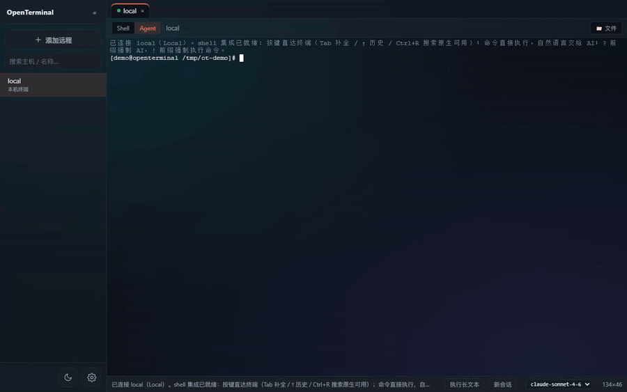
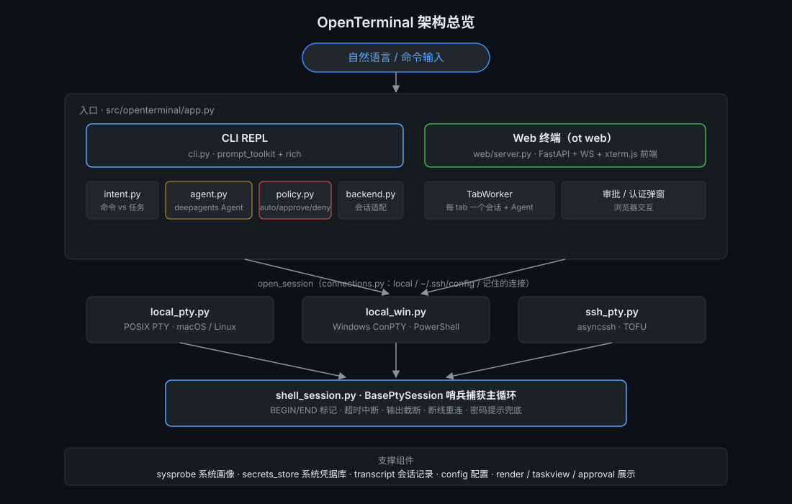

# OpenTerminal

[](https://github.com/jeean404/OpenTerminal/actions/workflows/ci.yml)
[](https://pypi.org/project/ot-cli/)
[](https://www.python.org/downloads/)
[](https://pypi.org/project/ot-cli/)
[](LICENSE)

**Tell your terminal what you want in plain language — it does the work.**

[中文文档](README.zh-CN.md) · [Install](#install) · [Security model](#security-model)

<div align="center">
  <br><br>
  
</div>

> ⚠️ **Beta**: OpenTerminal runs real commands on real machines — including
> production servers. Every state-changing command needs your approval (see
> [Security model](#security-model)), but please still read what you're approving.
> Security-sensitive disclosures: [SECURITY.md](SECURITY.md).

## Introduction

OpenTerminal is a natural-language terminal agent for people who live in a shell. Describe the outcome you want and it works out the commands, runs them in your real shell, and hands you a summary. Plain commands keep working exactly as you'd expect, and full-screen programs like vim/top/tmux take over the terminal natively — it *is* your terminal, not a command runner with a REPL on top.

It needs no extra dependencies: it runs in your terminal (`ot`) and in the browser (`ot web`) off the same core. Local shells and SSH hosts alike, across macOS, Linux and Windows.

The two GIFs above are recordings of the same task on the real interface — the first in the terminal, the second in the browser: a plain command, then plain language, then thinking and analysis, then the read-only probe running by itself, then the delete waiting at the approval gate, then the summary table. They're driven by a scripted agent, so they can be reproduced exactly — but the commands, the policy decisions and every line of output are real.

## What it does

**Natural-language tasks.** One sentence is one task: the AI streams its thinking and analysis, runs the commands, then summarises the result as a markdown table whose rows come from the actual output. Plain commands and plain sentences share one input line — `!` forces a command, `?` forces a task, Ctrl+C interrupts at any time. Slash commands are `/help` `/target` `/system` `/clear` `/model` `/exit`. Commands you type between tasks reach the model as a rolling summary (command, exit code, output tail) merged into the context, so they don't bloat the window. The status line shows session token usage — exact when the gateway reports it, a local estimate otherwise.

**Shell and remote.** Sessions are persistent: `cd`, exports and venvs survive across tasks, and full-screen programs run inline through true PTY passthrough. Package dialects are auto-detected (apt / yum / dnf / apk / pacman / brew) with a `/system` override. Hosts come from `~/.ssh/config`, an ad-hoc `user@host:port`, or remembered connections; passwords live in the OS credential store, never in plaintext files, and nested `ssh` / `sudo` / `su` prompts fill themselves in. Post-connect command sets handle jump-host hops and `su -` switches the moment a target is up — write `> @name=secret` once and only the reference is stored.

**Skills and tools.** Skill packs ship inside the package (`SKILL.md` mounted under `/skills/`) and the model pulls one in only when the task calls for it. From the web UI you can toggle them individually, upload a `.md` / `.zip`, or import a local folder. MCP servers go in through the Tools entry — paste a Claude Desktop / `.mcp.json` config and import several at once (stdio, HTTP, SSE); each can be toggled and test-connected, and they join the built-in tools.

**Web UI.** A server sidebar with multi-tab terminals; each tab switches between an Agent view (cards and approvals) and a plain Shell view, and shows its own connection status. The file panel supports chunked uploads that resume after a network interruption. Passwords and host keys are entered in browser dialogs, and binding to a non-loopback address requires a token. Settings cover terminal font size and scrollback, themes and wallpapers, skills, tools and models; the interface language switches between 中文 and English in place.

**Headless.** `ot exec -t <target> -c "<cmd>" --output json` runs one policy-gated command per call with machine-readable output — safe to wire into cron, CI, or another agent.

## Install

Three options: a pre-built binary (no Python needed), a package manager, or source.

**Pre-built binaries** — download from [Releases](https://github.com/jeean404/OpenTerminal/releases), unpack, and put `ot` on your `PATH`. Replace `vX.Y.Z` with the latest tag:

| Platform | Asset |
|---|---|
| macOS (Apple Silicon) | `ot-vX.Y.Z-macos-arm64.tar.gz` |
| macOS (Intel) | `ot-vX.Y.Z-macos-x86_64.tar.gz` |
| Windows (x64) | `ot-vX.Y.Z-windows-x64.zip` |

```sh
# macOS
tar -xzf ot-vX.Y.Z-macos-arm64.tar.gz
sudo mv ot/ot /usr/local/bin/ot        # or any directory on your PATH
```

On Windows, unzip and add the `ot` folder to your `PATH`, then run `ot.exe`.

> The Intel Mac binary is built and attached manually per release (GitHub retired its Intel macOS runners). If a release is missing it, install from PyPI instead — that works on both architectures.
>
> macOS may block the first launch (the binary is ad-hoc signed): clear the quarantine flag once with `xattr -cr "$(command -v ot)"`, or right-click → Open. The first run also triggers a one-time OS security scan; later runs start in under a second.
>
> Windows may show SmartScreen (the binary is unsigned): **More info → Run anyway**.

**pipx / uv** — the PyPI package is `ot-cli` (it installs the `ot` command; the importable module remains `openterminal`):

```sh
pipx install ot-cli
# or
uv tool install ot-cli
```

Requires Python 3.11+. The old name `open-terminal-agent` (0.1.0 only) was retired in favour of `ot-cli`.

**Source**:

```sh
conda create -n openterminal python=3.12 -y   # or any virtualenv
conda activate openterminal
pip install -e .
```

## Configuration

Model gateways are managed under **Settings → Models**: pick the protocol, URL, model and API key, then enable it — newly opened tabs use it, existing ones don't switch. Profile metadata is stored in `~/.openterminal/connections.db` and API keys in the OS credential store, never in the project config. The CLI stays compatible with environment variables and `[model]` in `config.toml`.

Everything else goes in `~/.openterminal/config.toml`:

```toml
[shell]
timeout_default = 120        # per-command wait budget (seconds)
max_output_bytes = 102400    # per-command output truncation
max_tool_turns = 10          # agent tool-call turn budget

[policy]
mode = "tiered"              # tiered | approve-all | deny-all
# auto_extra / approve_extra / deny_extra append exact-match custom rules

[target.prod-web]
mode = "ssh"
host = "prod-web.example.com"
user = "deploy"
# Post-connect command set — runs line by line right after login.
# A "> @name=secret" line stores the secret in the keyring and is kept as
# "> @name"; the password box then answers from that reference.
commands = [
  "su - deploy",
  "> @deploy_pw",
]
```

The config directory can be moved with `OPENTERMINAL_HOME` (the test suite uses this for isolation). Transcripts go to `~/.openterminal/sessions/`, host profiles are cached in `~/.openterminal/hosts.toml`.

## Supported platforms

| | |
|---|---|
| Operating systems | macOS, Linux, Windows |
| Local shell | PTY on macOS / Linux; ConPTY + PowerShell on Windows |
| Shells | zsh and bash ≥ 4 are fully featured; bash 3.2 (still shipped by macOS) can't see `READLINE_LINE`, so the natural-language trigger doesn't work there |
| Python | 3.11+ (needed for pipx / source installs; not for the pre-built binaries) |
| Model gateways | Anthropic-compatible and OpenAI-compatible, multiple profiles |

## Architecture

<div align="center">
  
</div>

Three layers: a natural-language front end (terminal or web), a deepagents (LangGraph) agent, and persistent shell sessions. Natural language goes straight to the agent for multi-turn tool use; command execution is a sub-capability of the agent over the same session. The tiered policy is enforced as agent middleware, so prompt content can't talk its way past the approval gate. Built-in skills are mounted as files under `/skills/`, so the agent loads them the same way it loads any other reference file; MCP tools come in through `langchain-mcp-adapters` and join the built-in set.

Display is a single pipeline: PTY bytes go straight to the terminal, shell-integration hooks keep the books via in-band OSC markers (history, exit codes, AI context), and agent tool commands are injected into the same PTY via `__ot_exec__`, so their output lands in place. Commands are strictly serial within a session — one PTY is one interactive shell, so concurrent agent `execute` calls queue up. Sentinel slicing remains only for non-display paths such as headless `ot exec` and capability probes.

There is no model-level long-term memory — the agent's checkpointer is in-memory and cleared on restart. What persists is factual state:

| Store | Location | Contents |
|---|---|---|
| Config | `~/.openterminal/config.toml` | gateway / shell budgets / policy / targets |
| Database | `~/.openterminal/connections.db` | remembered connections and command sets, model profiles, skill enable state, MCP servers, wallpaper state |
| Skills | `~/.openterminal/skills/` | user skill packs (`SKILL.md` per folder), overriding built-ins by name |
| Wallpapers | `~/.openterminal/wallpapers/` | custom wallpaper media; the browser keeps none of it |
| Command history | `~/.openterminal/history.db` | per-target history, replayed into the shell on reconnect |
| Passwords | OS credential store (keyring) | connection passwords and command-set secrets — never written to plaintext files |
| Host profiles | `~/.openterminal/hosts.toml` | per-host system profile cache |
| Transcripts | `~/.openterminal/sessions/<date>/` | JSONL of inputs, commands, approvals and summaries |
| Host keys | `~/.ssh/known_hosts` | written after TOFU confirmation |

## Modes

**Terminal (`ot`).** Runs in your own terminal: a local shell plus a main menu for connecting and managing hosts. A sentence is a task, a command runs in your real shell, and `!` / `?` force either one. Ctrl+C interrupts a task and returns you to the prompt; `/exit` quits. This is the single-pipeline implementation — command output, AI cards and command history all live in the same character stream.

**Browser (`ot web`).** Starts a web server (default <http://127.0.0.1:8080>). Pick a target from the server sidebar and open as many tabs as you like; each switches between an Agent view (cards and approvals) and a plain Shell view, and shows its own connection status. Passwords and host keys go through browser dialogs, and remembered passwords make reconnection password-free. For LAN access use `ot web --host 0.0.0.0 --token <TOKEN>` — a token is mandatory for non-loopback binds.

**Headless (`ot exec` / `ot list`).** Meant to be called as a subprocess by scripts and by other AI coding tools (Claude Code, Codex, opencode, …) without entering the REPL. One command per call, behind the same policy gate, structured JSON out. Exit codes are layered: the remote command's code passes through as-is (0–63) and tool errors use reserved codes above 64, so a caller can tell "the command failed" from "the call failed". Approvals never block headlessly — they come back as structured refusals, and the only way through is a human action.

## Security model

The rule of thumb: **looking is free; changing things needs your OK; disasters are refused.**

Three tiers (`src/openterminal/policy.py`):

- **auto** — read-only work runs on its own: `ls`/`cat`/`df`/`ps`, `git status/log`, `find` without `-exec/-delete`, and so on.
- **approve** — anything that modifies the system: deleting or writing files, installing packages, `systemctl`, `sudo`, network config, plus anything the static rules can't confidently judge. A panel opens: `y` execute / `e` edit / `n` reject / `a` allow for this session (a button in the web UI, with a second confirm for high-risk commands).
- **deny** — the catastrophic stuff is refused outright and the reason is fed back to the model so it changes course: `rm -rf /`, mkfs, `dd` to block devices, fork bombs, shutdown, redirects to /dev devices, and so on.

The gate is enforced as **agent middleware**, not in the prompt. A prompt is a request; middleware is a wall — no amount of persuasiveness gets past it. Rejected and failed commands aren't retried verbatim either: a failure is retried at most once, a rejected command can't be re-skinned, and tool-call turns are budget-bounded. Every input, command, approval and summary lands in a JSONL transcript under `~/.openterminal/sessions/`.

## What makes it different

**It's a real shell, not a command runner.** `cd`, exports and venvs survive across tasks and vim/top/tmux take over natively. Getting there means true PTY passthrough with a hook doing the bookkeeping via in-band markers — which is also why old shells like bash 3.2 are only partly supported (see [Supported platforms](#supported-platforms)).

**The gate is middleware, not a prompt.** Approval doesn't depend on the model behaving itself or on instructions in the system prompt; it's a hard check on the agent's tool-call path. That's the essential difference from tools that simply let the agent run.

**Failures are budgeted, not retried forever.** A failure is retried once at most, a rejected command can't come back disguised, and tool-call turns are capped. Endless self-correction is a big part of why agents lose people's trust.

**One request, every dialect.** The same request becomes apt on Ubuntu, yum on CentOS 7, dnf on Rocky, apk on Alpine and brew on macOS — with a `/system` override when detection gets it wrong.

**Everything is logged.** Inputs, commands, approval decisions and summaries all land in JSONL, so when something goes wrong you can see exactly what happened.

**No long-term memory, only factual state.** Session memory is cleared on restart. What stays behind is configuration, connections, history and credentials — it won't quietly remember things you didn't ask it to.

## License

[Apache License 2.0](LICENSE)
